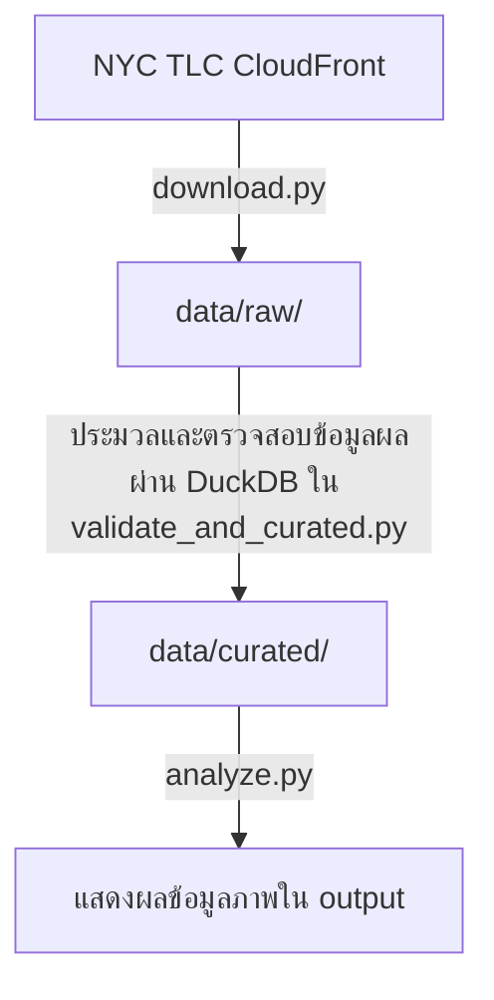

## About
Project นี้นั้นสร้างมาสำหรับงาน submission 2 ของวิชา CS341 เพื่อมาคำตอบโจทย์คือ
> "Which taxi type was the most used in the first half of 2024?"

## Key Architectural Decisions
1. เลือกใช้ DuckDB เป็นเครื่องมือหลักในการประมวลผล เนื่องจาก DuckDB ใช้การประมวลผลแบบ Vectorized Execution และจัดการข้อมูลนอกหน่วยความจำหลัก (Out-of-Core)ได้อย่างมีประสิทธิภาพทำให้ระยะเวลาการทำงานลดลง
2. จัดเก็บข้อมูลปลายทาง เป็นฟอร์แมต Parquet ซึ่งเป็น Columnar Storage ที่ช่วยรักษา Schema ของข้อมูลอย่างถูกต้องมีอัตราการบีบอัดที่สูงมาก(ช่วยประหยัดพื้นที่จัดเก็บได้ถึง 80%) และช่วยให้การ Query ข้อมูลเฉพาะคอลัมน์ในขั้นตอนถัดไปทำงานได้รวดเร็วขึ้นโดยไม่ต้องสแกนไฟลทั้งหมด

## Data flow diagram


## Installation and execution
```
git clone https://github.com/Teetad-Aumavichanee/CS341_submission2
cd nyc-taxi-pipeline
pip install -r requirements.txt
python execute_pipeline.py --config config.yaml
```